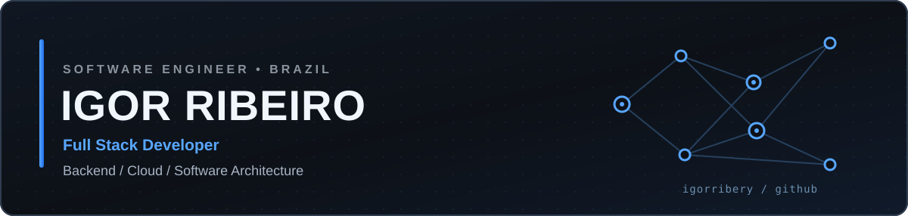

 

### About me

I'm a **Full Stack Developer** based in Brazil with **3+ years of experience** building web applications, APIs, and end-to-end products. I enjoy designing reliable backend systems, improving performance, and turning complex requirements into maintainable software.

- **Backend first:** Node.js, Go, NestJS, REST & GraphQL APIs.
- **Data & infrastructure:** PostgreSQL, Redis, Docker, AWS, caching, and asynchronous processing.
- **Full-stack delivery:** React, Next.js, TypeScript, testing, CI/CD, and cloud deployments.
- **Currently focused on:** backend architecture, distributed systems, Go, and practical AI integrations.

### Tech stack

  

 

| Backend & APIs | Frontend | Databases & Cloud |
| :--- | :--- | :--- |
| Node.js · Go · NestJS · REST · GraphQL | React · Next.js · TypeScript · Tailwind CSS | PostgreSQL · Redis · Prisma · AWS · Docker |

### Featured projects

<table>
  <tr>
    <td width="50%" valign="top">
      <h3><a href="https://github.com/igorribery/criptoinvest">CriptoInvest</a></h3>
      
Full-stack cryptocurrency tracking platform with portfolio management, authentication, and automated price alerts.

      
<strong>Stack:</strong> Next.js · Node.js · PostgreSQL · AWS (Amplify, CloudFront, Elastic Beanstalk, RDS, Lambda)

      
<a href="https://github.com/igorribery/criptoinvest">Explore project →</a>

    </td>
    <td width="50%" valign="top">
      <h3><a href="https://github.com/igorribery/taskflow">TaskFlow</a></h3>
      
Collaborative Kanban workspace with JWT authentication, task history, and a local AI assistant with in-memory RAG.

      
<strong>Stack:</strong> Next.js · NestJS · Prisma · PostgreSQL · Redis · Ollama

      
<a href="https://github.com/igorribery/taskflow">Explore project →</a>

    </td>
  </tr>
</table>

### GitHub activity

Statistics are generated by a third-party service and may be delayed or exclude private activity. Language charts describe repository activity, not proficiency.

---

**Interested in backend engineering, scalable systems, or building full-stack products?**

[Let's connect on LinkedIn](https://www.linkedin.com/in/igorrds113/) · [Visit my portfolio](https://igor-ribeiro.vercel.app/)

